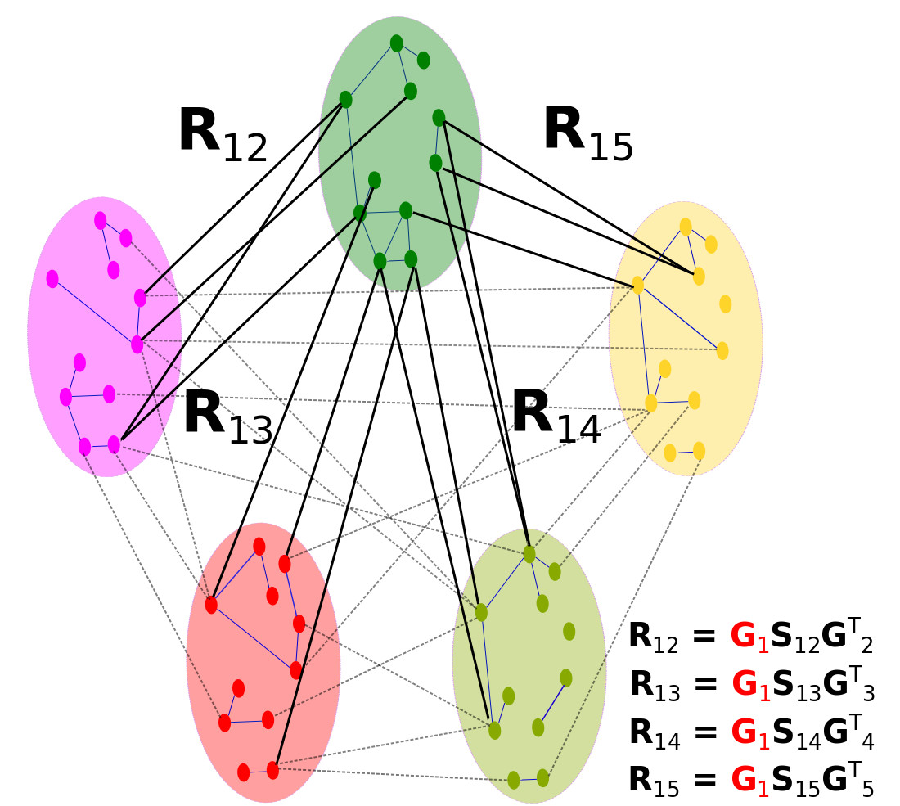

<div align="center">


# Fuse: Multiple Network Alignment via Data Fusion

**Vladimir Gligorijević, Noël Malod-Dognin and Nataša Pržulj**

Corresponding author: Prof. N. Pržulj, natasa.przulj@mbzuai.ac.ae



</div>

Fuse is a global multiple network aligner. First, it computes new similarity scores between proteins by fusing sequence similarities and network wiring patterns over all proteins in all PPI networks being aligned, using non-negative matrix tri-factorization (NMTF). Second, it constructs a one-to-one global multiple network alignment using an approximate maximum weight k-partite matching solver.

## Downloads

- [Fuse for Linux x64](https://github.com/przulj-lab/fuse/releases/download/v1.0/FUSE_software.7z)
- [Dataset for Fuse](https://github.com/przulj-lab/fuse/releases/download/v1.0/FUSE_dataset.7z)
- [Supplementary material (PDF)](https://github.com/przulj-lab/fuse/releases/download/v1.0/FUSE_supplement.pdf)
- [Table of predicted clusters (XLS)](https://github.com/przulj-lab/fuse/releases/download/v1.0/predicted_clusters_official_gene_symbol.xls)

## How to run Fuse

### Step 1: Data fusion (MATLAB)

You need:
- MATLAB R2013a or newer
- the PPI network files, in edgelist format
- a file with the sequence similarities between proteins (e.g. 1 − e-value)
- the number of NMTF iterations, the list of rank parameters, and the gamma parameter

Example (in the MATLAB console):
```matlab
run_nmtf({'./Nets/CElegans.edgelist', './Nets/DMelanogaster.edgelist', './Nets/HSapiens.edgelist', './Nets/MMusculus.edgelist', './Nets/SCerevisiae.edgelist'}, 'sequence_scores.lst', [80, 90, 80, 70, 50], 1000, 0.01, 'nmtf_scores.lst')
```

This produces `nmtf_scores.lst`, the input for the alignment step.

### Step 2: Alignment

You need:
- the PPI network files, in LEDA format (`.gw`)
- a network list file with the path to each network, one per line, e.g.:
  ```
  ./Nets/CElegans.gw
  ./Nets/DMelanogaster.gw
  ./Nets/HSapiens.gw
  ./Nets/MMusculus.gw
  ./Nets/SCerevisiae.gw
  ```
- the sequence similarity file and the NMTF-based similarity file from step 1

Example:
```bash
./FUSE.exe -n network_list.txt -s sequence_scores.lst -t nmtf_scores.lst -o an_output_file
```

Run `./FUSE.exe -h` for the full list of parameters.

## Other multiple network alignment algorithms

- [NetCoffee](https://code.google.com/archive/p/netcoffee/)
- [Smetana](https://biomlsp.com/)
- Beams
- [IsoRankN](https://cb.csail.mit.edu/cb/mna/)

## Citation

V. Gligorijević, N. Malod-Dognin and N. Pržulj. Fuse: multiple network alignment via data fusion. *Bioinformatics* 32(8), 1195–1203 (2016). https://doi.org/10.1093/bioinformatics/btv731
